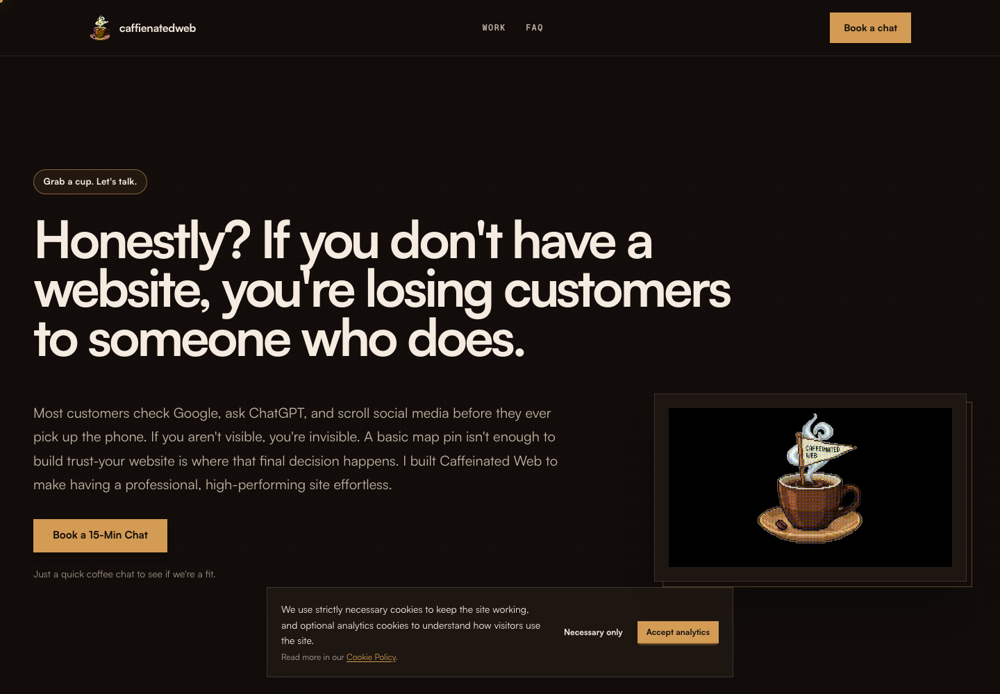

# Caffeinated Web

A coffee-inspired website for a small web design studio. An animated landing page introduces the offer, showcases website concepts, answers common questions, and leads visitors into a discovery-call booking flow.

**Next.js 16 · React 19 · TypeScript · Tailwind CSS 4 · GSAP · Motion**

[Website](https://caffienatedweb.com) · [Development](#run-locally) · [Design system](DESIGN.md) · [Deployment](DEPLOY.md)



## What to explore

- **Coffee-themed visual identity:** warm paper tones, expressive typography, animated illustrations, and coordinated scroll transitions.
- **Responsive experience:** layouts for desktop and mobile, plus reduced-motion behavior.
- **Booking flow:** a Calendly dialog with an email fallback and keyboard interactions.
- **Search presentation:** page metadata, structured data, canonical URLs, sitemap, and robots configuration.
- **Consent-aware analytics:** optional PostHog tracking controlled by the cookie-consent interface.
- **Portable hosting:** static HTML, CSS, and JavaScript exported into `out/`.

The work section includes website concepts for a gym and a café. These demonstrate design work; they are not evidence of client outcomes.

## Run locally

Use Node.js 22 LTS and npm.

```sh
git clone https://github.com/MohZak-AI/caffeinated-web.git
cd caffeinated-web
npm ci
npm run dev
```

Open [localhost:3000](http://localhost:3000). Copy `.env.example` to `.env.local` only when configuring the production domain, Search Console, or optional PostHog analytics. The site can be explored locally without analytics credentials. Values prefixed with `NEXT_PUBLIC_` are shipped to the browser; never put secrets in them.

## Build and check

```sh
npm run lint
npx tsc --noEmit
npm run build
npm start
# In a separate terminal, run browser checks:
npx playwright install chromium webkit
npm run test:e2e
```

This project uses `output: "export"`. Deploy the generated `out/` directory to a static host. `npm start` previews that export locally on port 3000; `next start` is not used for static exports. See [DEPLOY.md](DEPLOY.md) for hosting configuration.

The Playwright suite covers landing-page content, booking interactions, cursor alignment, scrolling, and mobile behavior. Tests launch their own development server on port 3001; set `PLAYWRIGHT_BASE_URL` to test another deployment.

## Project map

| Path | Responsibility |
| --- | --- |
| `app/_components/` | Landing sections, booking, navigation, motion, and consent UI |
| `app/_content/` | Centralized marketing and policy content |
| `app/_lib/posthog.ts` | Analytics initialization and events |
| `app/globals.css`, `app/espresso.css` | Design tokens, layouts, and coffee-themed styling |
| `tests/e2e/` | Browser acceptance checks |
| `public/` | Brand assets and concept previews |

## Configuration and release notes

The public brand is spelled **caffienatedweb** in its domain and marketing content. The repository uses the name **caffeinated-web**.

Review booking configuration, analytics settings, policy content, and asset rights before deploying your own copy. No repository-wide reuse license has been selected.
